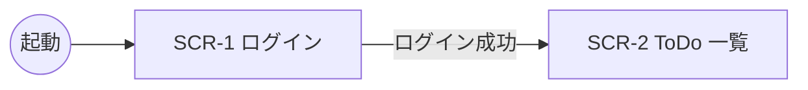

# 画面遷移: シンプル ToDo

## 参照元

- `docs/02-ux/stories/`
- `docs/02-ux/personas.md`

## 画面一覧

| ID | 画面名 | 目的 | ストーリー |
|---|---|---|---|
| SCR-1 | ログイン | 本人確認 | US-1 |
| SCR-2 | ToDo 一覧 | 追加・完了・一覧表示 | US-2 |

## 遷移

| 遷移元 | 遷移先 | 契機 | ストーリー |
|---|---|---|---|
| （起動） | SCR-1 | 未ログインで起動 | US-1 |
| SCR-1 | SCR-2 | ログイン成功 | US-1 |

## 遷移図

