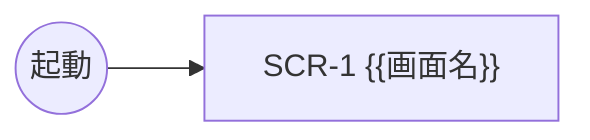

# 画面遷移: {{プロダクト名}}

<!--
小項目 2-3「画面遷移の定義」の成果物。置き場: docs/02-ux/screens.md
引き渡し物（段階 3 の入力）。
- 画面は「画面一覧」の表（第 1 列の見出しが ID）で定義する
- 全ストーリー（docs/02-ux/stories/）が「画面一覧」のどれかの行で参照されること
- 画面の中身（レイアウト、要素、状態）は段階 3 の画面仕様で決める。ここでは画面の単位と遷移だけを決める
-->

## 参照元

- `docs/02-ux/stories/`
- `docs/02-ux/personas.md`

## 画面一覧

| ID | 画面名 | 目的 | ストーリー |
|---|---|---|---|
| SCR-1 | {{画面名}} | {{目的}} | {{US-n（複数はカンマ区切り）}} |

## 遷移

<!-- 起点（アプリの起動、通知など）は遷移元に「（起動）」のように書く。遷移の無い単一画面なら遷移先に「—」 -->

| 遷移元 | 遷移先 | 契機 | ストーリー |
|---|---|---|---|
| {{SCR-n または（起動）}} | {{SCR-n}} | {{操作・条件}} | {{US-n}} |

## 遷移図

<!-- 任意。Mermaid のノード名に ID のハイフンは使えないため、ラベルに ID を書く -->

